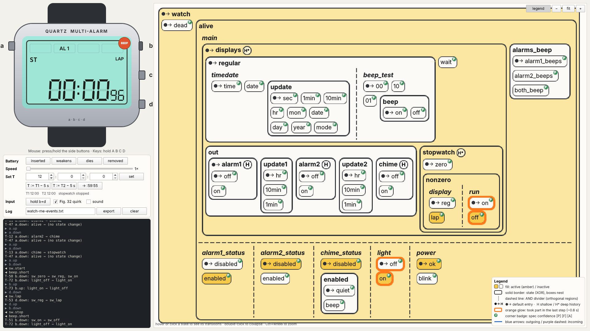
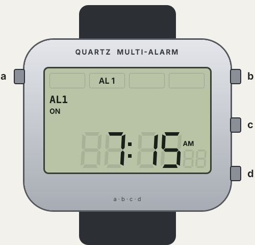
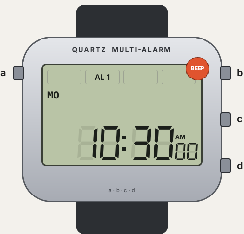
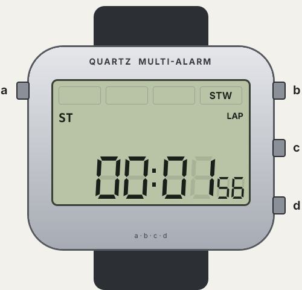
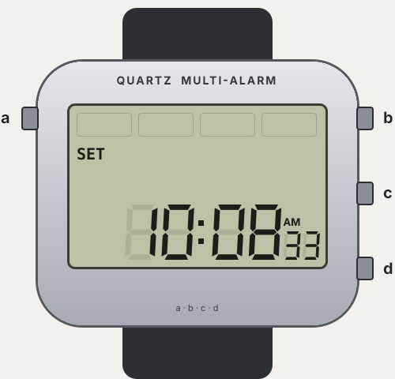
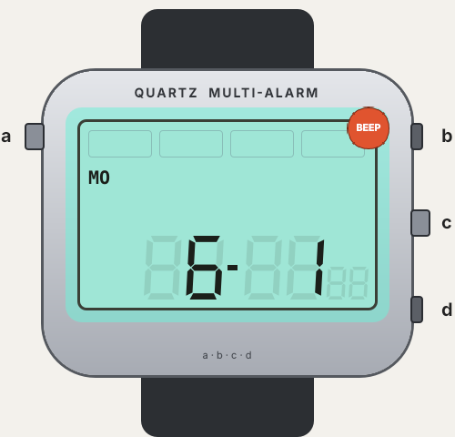
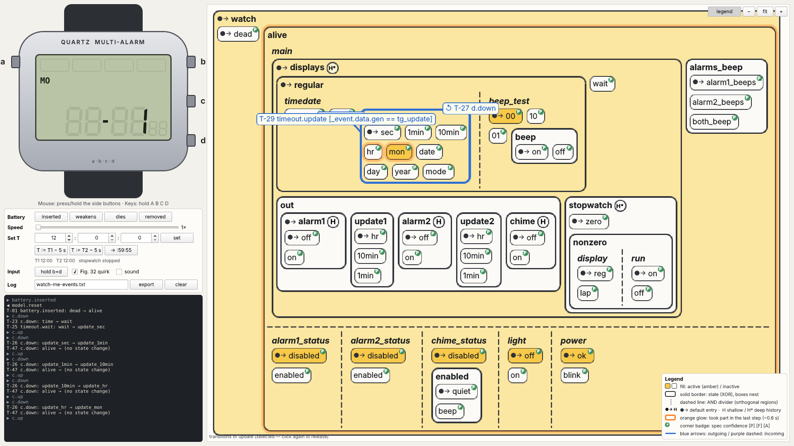

# watch-me

[](https://github.com/j-brent/watch-me/actions/workflows/ci.yml)

An executable version of the most famous statechart in software engineering: the
**Citizen Quartz Multi-Alarm III** digital watch from David Harel's 1987 paper
*"Statecharts: A Visual Formalism for Complex Systems"*. It is built with Qt Quick
and Qt SCXML.

Harel's statecharts are the basis of UML state diagrams and of SCXML. Qt's
State Machine framework also cites the paper as its source of concepts and notation.
This project closes the loop: it takes the paper's full watch statechart (Fig. 31),
writes it as one SCXML document, and runs it behind an interactive watch with a
live view of the statechart.



## What it does

- **Watch face.** A seven-segment LCD drawn with Qt Quick Shapes (no font assets),
  with four buttons placed as in the paper's Fig. 7 (a upper left; b, c, d on the
  right). It has a backlight, a beeper indicator (and optional sound), indicators
  for alarm 1, alarm 2, chime and the running stopwatch, a 2 Hz blink of the field
  being set, and a 1 Hz low-battery blink.
- **The whole statechart, in SCXML.** [`statechart/watch.scxml`](statechart/watch.scxml)
  models all six orthogonal components of `alive`: main (displays and alarms-beep),
  alarm 1, alarm 2, chime, light and power. It also covers time/date/12-24h update,
  alarm setting, the stopwatch with lap, the beep-test component, deep and shallow
  history, the 2-minute returns, and `clh(main*)` on battery death. All behaviour
  lives there. C++ only holds values (clock, alarm times, stopwatch counter), and
  QML only renders.
- **Live statechart view.** The SCXML is parsed at runtime and drawn as literally
  nested states, with dashed dividers between orthogonal regions as in Harel's
  figures. It shows ●→ default entries and H/H\* history. The active configuration
  is highlighted, and states touched by the last step glow for about 0.6 s.
  Hovering or clicking a state draws its incoming and outgoing transitions with
  their spec rows. Every transition that fires is logged as
  `T-xx event: source → target`. A legend gives each visual channel a single
  meaning.
- **Simulation panel.** Battery inserted/weakens/dies/removed, clock speed
  1×–600×, set T, jump to 5 s before T1/T2 or before the next whole hour,
  "hold b+d", the Fig. 32 quirk on/off, sound on/off, and export of the event log.

| | | |
|---|---|---|
|  |  |  |
| `time` | `alarm1.on` (alarm 1 enabled) | `alarms-beep` (LCD flashes) |
|  |  |  |
| `stopwatch` (lap, running) | `update.hr` (field blinks) | `beep-test.beep` + `light.on` |



## Controls

| Input | Effect |
|---|---|
| Mouse press/release on a side button | `x.down` / `x.up` |
| Keys **A B C D** (hold) | same, so **b+d** works for the beep-test |
| Click / hover a state in the view | show its transitions (click again to release) |
| Double-click a compound state | collapse / expand |
| Ctrl + wheel, `−` `fit` `+` | zoom; drag to pan |

Some things to try (all from the paper):

- **c held for 2 s** in time → update; **c** steps sec → 1min → 10min → hr → mon →
  date → day → year → mode → time; **d** increments; **b** returns.
- **b in update** turns on the light *and* leaves update (orthogonality, p. 247).
- In **update.mon**, press **d** then **b** and keep both held: you end in time, one
  month ahead, with the beeper beeping and the light on (p. 250).
- Start the stopwatch, take a lap, cycle through the other displays and come back:
  it is still running, and you return to lap (deep history).
- Enable alarm 1, then "T := T1 − 5 s": any button, or 30 s, returns to exactly
  the display you left (H\*).

## Building

Requirements: Qt ≥ 6.4 with Qt Quick, Qt Quick Shapes, Qt SCXML and Qt Test (Qt
Multimedia optional, for sound); CMake ≥ 3.21; Ninja; a C++20 compiler; Python 3
for the conformance check.

```sh
cmake -B build -G Ninja            # add -DCMAKE_PREFIX_PATH=/path/to/Qt/6.x/<platform> if needed
cmake --build build
ctest --test-dir build             # tst_watch, tst_model, tst_tree, conformance
./build/watch-me                   # --auto-insert to start with a battery
```

The project was developed with the Ubuntu 24.04 packages (Qt 6.4.2):
`qt6-base-dev qt6-declarative-dev qt6-scxml-dev qml6-module-qtquick-shapes
qml6-module-qtquick-controls qml6-module-qtquick-layouts qml6-module-qtquick-window
qml6-module-qtqml-workerscript qml6-module-qtquick-templates` (+ `qt6-multimedia-dev`
for sound). With `aqtinstall` (Qt Quick Shapes ships with the base Qt Declarative
module; only SCXML and, optionally, Multimedia are add-ons):
`aqt install-qt linux desktop 6.8.3 linux_gcc_64 -m qtscxml qtmultimedia`.

On macOS the app builds as `build/watch-me.app`, on Windows as a GUI executable.
`cmake -B build -G Ninja -DWATCHME_DEPLOY=ON` plus `cmake --install build --prefix dist`
produces a self-contained install with the Qt runtime deployed next to it (Qt ≥ 6.5).

## CI and releases

- **CI** ([`.github/workflows/ci.yml`](.github/workflows/ci.yml)) runs on every push
  to `main` and every pull request. On Ubuntu 24.04, Windows (MSVC 2022) and macOS 14
  with Qt 6.8 LTS, it builds and runs `ctest`. It then deploys the Qt runtime,
  smoke-tests the deployed app headless, and uploads the package as an artifact. A
  fourth job builds and tests against Ubuntu's own Qt 6.4 packages, the minimum
  supported version.
- **Release** ([`.github/workflows/release.yml`](.github/workflows/release.yml)):
  push a tag such as `v1.0.0`. It runs the CI workflow on the tag, and only if all
  three platforms build, test and package successfully does it publish a GitHub
  release with the three packages and a `SHA256SUMS.txt`:
  `watch-me-<tag>-linux-x86_64.tar.gz`, `watch-me-<tag>-windows-x64.zip`,
  `watch-me-<tag>-macos.dmg`. Tags with a hyphen (`v1.0.0-rc1`) become
  pre-releases.

  ```sh
  git tag v1.0.0 && git push origin v1.0.0
  ```

  The macOS app is ad-hoc signed but not notarized (right-click → Open the first
  time). The Windows build is unsigned. The Linux tarball needs the usual X11/Wayland
  libraries of the desktop (e.g. `libxcb-cursor0`).

Headless: `QT_QPA_PLATFORM=offscreen`. `tools/screenshots.sh` regenerates
`docs/screenshots/` with the app's `--script`/`--grab` options.

## Repository contents

| Path | Purpose |
|---|---|
| `docs/STATECHART-SPEC.md` | **Source of truth** for behaviour: events, hierarchy, every transition as a numbered row `T-xx` with its confidence tag |
| `statechart/watch.scxml` | The machine. Every transition carries `<!-- T-xx -->` and `<log label="T-xx"/>` |
| `statechart/layout.json` | View hints only (button placement, rows/columns of the statechart view) |
| `src/` | `WatchModel` (values), `ButtonRouter` (input), `ScxmlTreeModel` + `TransitionTracer` + `SpecTags` (view data), `Beeper` (optional sound) |
| `qml/` | `WatchFace`, `Lcd`, `SevenSegment`, `StatechartView`, `StateBox`, `TransitionOverlay`, `Legend`, `SimPanel`, `EventLog` |
| `tests/` | `tst_watch` (one check per T-xx + scenarios), `tst_model`, `tst_tree`, `conformance.py` (spec ↔ SCXML ↔ tests) |
| `docs/DESIGN-NOTES.md` | Step 0 corrections, decisions, Qt workarounds, deviations |
| `docs/VERIFICATION.md` | Walk-through of every T-xx in the running app (68/68 ✓), generated by `tools/verify.py` |
| `tools/` | `screenshots.sh` (regenerates `docs/screenshots/`), `verify.py` (P8 walk-through) |
| `PLAN.md` | The implementation plan this was built from |
| `docs/harel1987.pdf` | The paper (44 pp., from https://www.state-machine.com/doc/Harel87.pdf). Kept for private study; don't make the repo public with it included |

## Fidelity

The spec was first drafted from memory. Before any code was written, every row was
checked against the scanned figures (Step 0, all figures legible), and every row
is now tagged **[P]**, confirmed against the paper's prose and/or figures. The
corrections were substantial and are listed in
[DESIGN-NOTES §1](docs/DESIGN-NOTES.md#1-step-0--spec-verified-against-harel-1987).
For example, beep-test is an orthogonal component of `regular`, not a display
state. The stopwatch is entered through deep history. Battery death leaves from
`power.blink`. The alarm displays have off/on substates synchronised with the
status components.

Where the paper is silent or SCXML/Qt differ, the choice is documented in
[DESIGN-NOTES §2](docs/DESIGN-NOTES.md#2-decisions-d-n). The main ones:

- `clh(main*)` has no SCXML equivalent and is emulated with history-valid flags
  (D-2).
- The paper's `d → H` self-entries in the update states are targetless
  increments in SCXML. The configuration after the step is identical (D-4).
- All three 2-minute returns restart on any button, following the prose (D-3).
- Fig. 32 (a silences the beep-test) is behind a flag, on by default.
- Qt 6.4 specifics: `type="qt:signal"` is rejected, so outgoing events are plain
  `<send>`s (D-11). One transition conflict needed an explicit priority guard
  (D-12).

[docs/VERIFICATION.md](docs/VERIFICATION.md) walks every row in the running app.
The app binary is driven through its normal input path, and the app's own event log
is the evidence. The open deviations are summarised in
[DESIGN-NOTES §3](docs/DESIGN-NOTES.md#3-open-deviations-from-the-paper-summary).

## Working on this repo with Claude Code

See `CLAUDE.md`. The main rule: change the spec first, then the SCXML, then the
tests, and keep every transition traceable to a `T-xx` row (`tests/conformance.py`
enforces it).

## References

- D. Harel, "Statecharts: A Visual Formalism for Complex Systems",
  *Science of Computer Programming* 8 (1987) 231–274.
  https://doi.org/10.1016/0167-6423(87)90035-9
- Qt State Machine framework overview (cites Harel as the basis of its concepts and notation):
  https://doc.qt.io/qt-5/statemachine-api.html
- Qt SCXML: https://doc.qt.io/qt-6/qtscxml-index.html
- W3C State Chart XML (SCXML) Recommendation: https://www.w3.org/TR/scxml/
